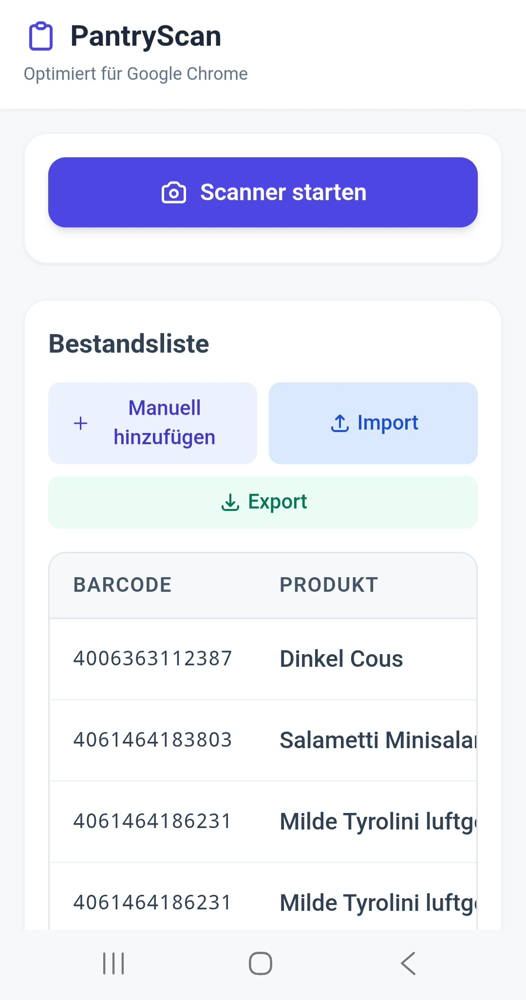
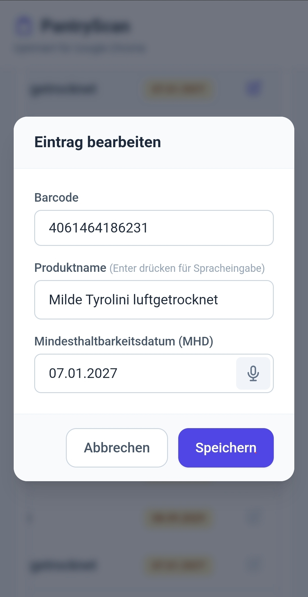

# PantryScan
&#x1F537; app for managing the pantry (foods in kitchen) easily &#x1F537;

#food #kitchen

&#x27A1; **Essensvorräte einfach mit einem Barcode-Scanner in einer Tabelle organisieren.**

*erstellt mit Gemini Argon*

**PantryScan_*.html** herunterladen und mit Google Chrome auf dem Android-Smartphone öffnen. 

*Erfolgreich getestet mit Samsung Smartphone, Android 9*

## Umfang ##
- Barcodes von Lebensmittel-Produkten einscannen
- Lebensmittel werden erkannt 
- per automatischer Funktion kann das Mindesthaltbarkeitsdatum diktiert werden.
- Die Ergebnisse werden in eine Tabelle geschrieben.
- Die Tabelle kann als CSV-Datei heruntergeladen werden.
- Import der CSV-Datei
- Manuelles Eintragen
- Erfasste Produkte löschen

## Versionen ##

### Version 1.1 ###
- Basisversion
